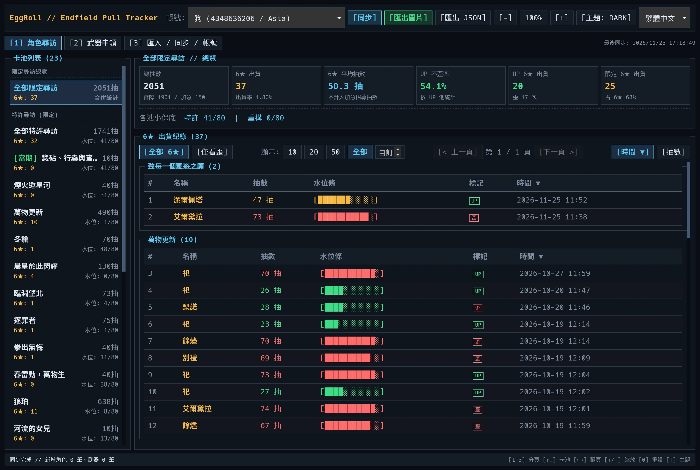

# EggRoll // Endfield Pull Tracker

[繁體中文](README.md) | **English**

A minimalist, plain-text TUI-styled local gacha/pull analyzer for *Arknights: Endfield*.

Supports 5 languages: 繁體中文, 简体中文, 日本語, English, and 한국어.



## Features

- **Plain-Text TUI Interface**: No bloated character portraits or meaningless pie charts. Built with embedded `Hack` and `Noto Sans CJK` fonts, presenting progress bars, tables, and the entire UI in clean ASCII style.
- **Resilient to Game Updates**: Because the UI is purely text-based and uses nothing beyond pull history data, new game patches won't break the visual layout even if the author hasn't updated the app yet. Updates are only necessary if new special-rule banner types are introduced or if the official pull history API changes.
- **No 5★ Clutter**: 5★ operators are easy to max out into surplus tokens, which quickly clutters the history list. EggRoll intentionally excludes 5★ character records to keep the focus on 6★ pulls.
- **Instant 5-Language Switching**: Built-in localization tables for characters, 6★ weapons, and banner names (sourced from [akedata.wiki](https://www.akedata.wiki/)). Switching UI languages updates all displayed records immediately while keeping `store.json` and AKEGF raw data untouched.
- **Official Account Login & Sync**: Built-in official login window supporting both Global (Asia / Americas / Europe, etc.) and CN servers. Log in to fetch and incrementally sync your pull history automatically—no manual log hunting or token extraction required (manual token/URL input is also supported).
- **AKEGF v0.4 Compatible**: Supports standard [AKEGF v0.4](https://www.akedata.wiki/?plugin=akegf&id=home) import and export.
- **100% Local Execution**: Runs completely offline/locally with zero telemetry—I have zero interest in spying on your butt.

## Download & Run

- **Windows**: Download the latest `.exe` executable from the GitHub [Releases](https://github.com/ribeye0/eggroll-endfield/releases) page and run it directly.
- **Linux**: Download the `AppImage` from [Releases](https://github.com/ribeye0/eggroll-endfield/releases), make it executable (`chmod +x`), and run it.

## Config & Data Path

Application settings and pull history (`store.json`) are stored at:

| OS | Path |
| --- | --- |
| Linux | `~/.config/eggroll/` |
| Windows | `%APPDATA%\eggroll\` |

## Development & Build

```bash
pnpm install
pnpm test
pnpm build
pnpm tauri dev
pnpm tauri build
```

## LICENSE
[MIT](LICENSE)
