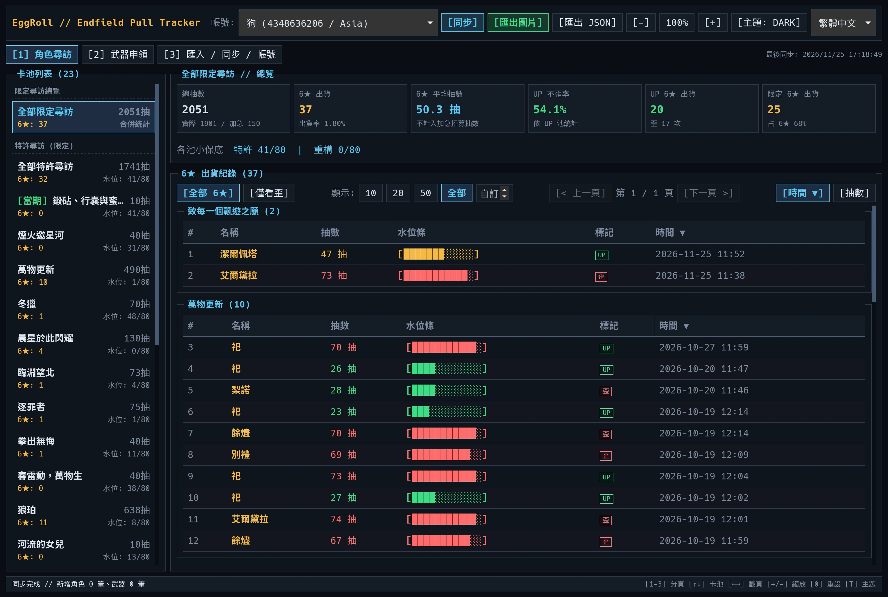

# EggRoll 終末地抽卡分析工具

**繁體中文** | [English](README.en.md)

極簡、純文字 TUI 風格的《明日方舟：終末地》本地抽卡分析工具。

支援繁體中文、简体中文、日本語、English、한국어 五種語言。



## 特色

- **純文字 TUI 風格介面**：無多餘角色圖片與意義不明的圓餅圖，內嵌 `Hack` 和 `Noto Sans CJK` 字體，以 ASCII 呈現進度條、表格與整體介面。
- **無懼版本更新、作者跑路**：因採純文字介面，本來就不會用到尋訪紀錄以外的資源，故不用擔心版本更新時的抽卡統計會因為作者來不及更新圖片而影響視覺觀感。基本上只有出了新的特殊規則卡池或是官方未來更改了查詢尋訪紀錄的方式才有必要更新。
- **去除 5★ 角色視覺干擾**：本遊戲 5★ 角色很容易集滿潛能溢出信物，介面上加入 5★ 角色易顯得雜亂冗餘，故本工具不統計 5★ 角色的抽取紀錄。
- **五語系即時轉換**：內建角色、6★ 武器與卡池名稱對照表（資料來源：[akedata.wiki](https://www.akedata.wiki/)），切換介面語言時歷史紀錄會同步轉換，同時保留 `store.json` 與 AKEGF 匯出原始資料。
- **支援官方帳號登入直接同步**：內建官方登入視窗，支援國際服（亞服／歐美服等）與中國官方服，登入後即可自動取得紀錄並增量同步，不需手動翻找日誌或抓取 Token。
- **AKEGF v0.4 相容**：支援 [AKEGF v0.4](https://www.akedata.wiki/?plugin=akegf&id=home) 標準匯入與匯出。
- **完全本地執行**：我沒興趣監視你的屁眼。

## 下載與執行

- Windows 使用者可直接前往 GitHub [Releases](https://github.com/ribeye0/eggroll-endfield/releases) 頁面下載最新版本的執行檔。
- Linux 使用者可使用 AppImage。

## 設定檔路徑

應用程式的設定與抽卡紀錄（`store.json`）儲存於以下路徑：

| 作業系統 | 路徑 |
| --- | --- |
| Linux | `~/.config/eggroll/` |
| Windows | `%APPDATA%\eggroll\` |

## 開發與建置

```bash
pnpm install
pnpm test
pnpm build
pnpm tauri dev
pnpm tauri build
```

## LICENSE
[MIT](LICENSE)
